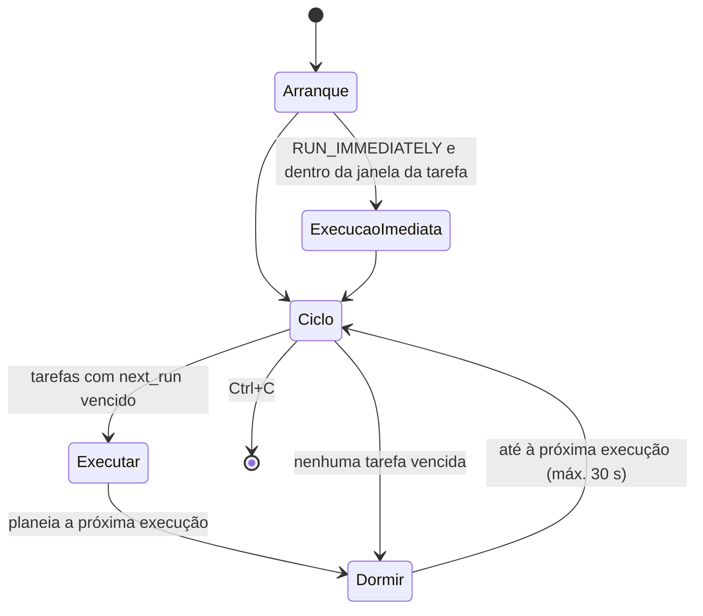

# Agendamento

Implementado pela classe [`Scheduler`][app.scheduler.scheduler.Scheduler]. Cada rotina é uma
[`ScheduledTask`][app.scheduler.scheduler.ScheduledTask] com o seu próprio
[`TaskSchedule`][app.scheduler.scheduler.TaskSchedule].

## Tarefas

| Tarefa                     | Horário por omissão                | Configuração                 |
| -------------------------- | ---------------------------------- | ---------------------------- |
| Stock                      | Diário, das 08:00 às 23:00, de hora a hora | `STOCK_SCHEDULE_*`   |
| Códigos de barras          | Diário, às 08:00, 12:00 e 16:00    | `BARCODES_SCHEDULE_*`        |
| Emails de satisfação       | Diário, às 06:00                   | `CUSTOMER_EMAILS_SCHEDULE_TIME` |
| Transferência de ficheiros | Diário, das 08:00 às 18:00, de hora a hora | `SCHEDULE_START_TIME`, `SCHEDULE_END_TIME`, `SCHEDULE_INTERVAL_MINUTES` |

## Regras de execução

As execuções estão **alinhadas ao relógio**: ocorrem na hora de início e depois a cada intervalo,
até à hora de fim (inclusive). Por exemplo, `08:00`–`16:00` com intervalo de `240` minutos
executa às `08:00`, `12:00` e `16:00`.

Se a hora de início for superior à de fim (ex.: `22:00`–`06:00`), a janela é interpretada como
atravessando a meia-noite.

Os meses em `SCHEDULE_MONTHS` aplicam-se a todas as tarefas.

## Ciclo principal

As tarefas correm **sequencialmente**, nunca em simultâneo. Se várias coincidirem na mesma hora,
executam pela ordem definida em [`build_tasks()`][main.build_tasks].

!!! note "Horários ultrapassados"
    A próxima execução é calculada depois de a tarefa terminar. Se uma tarefa demorar mais do que
    o intervalo, os horários entretanto ultrapassados são ignorados. Se o processo estiver parado
    à hora prevista, essa execução não é recuperada.

## Execução única

Com `SCHEDULE_ENABLED=False`, [`Scheduler.run_once()`][app.scheduler.scheduler.Scheduler.run_once]
executa uma vez e termina, sem verificar os meses:

- a transferência de ficheiros corre sempre;
- as restantes tarefas só correm se tiverem horário previsto para o minuto atual.
