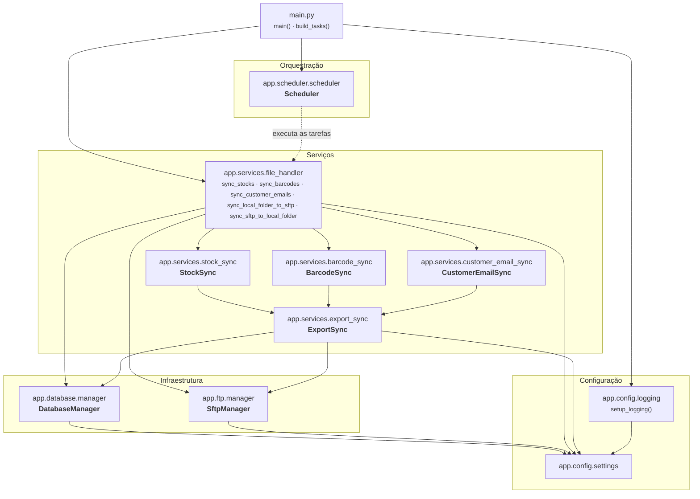
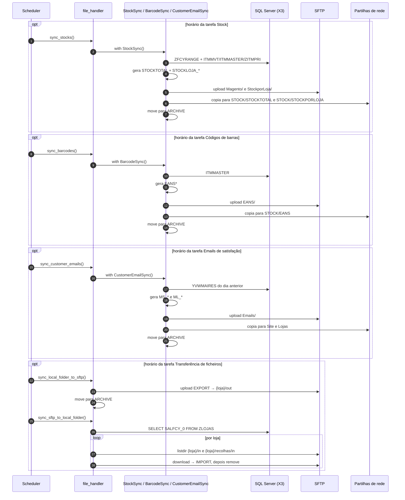

# Arquitetura

A aplicação está organizada em camadas simples: **configuração**, **infraestrutura**
(acesso à base de dados e ao SFTP), **serviços** (regras de negócio) e **orquestração**
(`main.py` + agendador).



## Módulos

| Módulo                          | Responsabilidade                                                                 |
| ------------------------------- | -------------------------------------------------------------------------------- |
| `main`                          | Ponto de entrada. Configura o logging e decide entre modo agendado ou execução única. Define as tarefas em [`build_tasks`][main.build_tasks]. |
| `app.config.settings`           | Lê o `.env` e expõe constantes (BD, SFTP, caminhos, logging, agendamento).       |
| `app.config.logging`            | [`setup_logging`][app.config.logging.setup_logging] — consola + ficheiros `info`/`error`. |
| `app.database.manager`          | [`DatabaseManager`][app.database.manager.DatabaseManager] — *context manager* SQLAlchemy para SQL Server via `pymssql`. |
| `app.ftp.manager`               | [`SftpManager`][app.ftp.manager.SftpManager] — *context manager* paramiko com verificação estrita de `known_hosts`. |
| `app.scheduler.scheduler`       | [`Scheduler`][app.scheduler.scheduler.Scheduler] — execução de várias tarefas, cada uma com a sua janela horária e intervalo, e meses permitidos. |
| `app.services.export_sync`      | [`ExportSync`][app.services.export_sync.ExportSync] — base das rotinas de exportação: ligações, envio, cópia para o storage e arquivo. |
| `app.services.stock_sync`       | [`StockSync`][app.services.stock_sync.StockSync] — extrai stock do X3, gera ficheiros e envia-os. |
| `app.services.barcode_sync`     | [`BarcodeSync`][app.services.barcode_sync.BarcodeSync] — extrai os códigos de barras do X3, gera o ficheiro e envia-o. |
| `app.services.customer_email_sync` | [`CustomerEmailSync`][app.services.customer_email_sync.CustomerEmailSync] — extrai os emails de satisfação do X3, gera os ficheiros e envia-os. |
| `app.services.file_handler`     | Funções de orquestração dos fluxos e regras de roteamento de ficheiros.          |

## Padrões utilizados

### Context managers para recursos externos

Tanto a ligação à base de dados como a ligação SFTP são abertas em `__enter__` e libertadas em
`__exit__`, garantindo o fecho mesmo em caso de exceção:

```python
with DatabaseManager() as db:
    rows = db.fetch_data('SELECT ... FROM GNPROD.ZLOJAS')

with SftpManager() as sftp:
    sftp.upload_file('local.txt', '/remote/E01/out/local.txt')
```

`ExportSync` compõe os dois: abre ambas as ligações no seu próprio `__enter__` e fecha-as no
`__exit__`. `StockSync`, `BarcodeSync` e `CustomerEmailSync` herdam este comportamento, bem como
o envio, a cópia para o storage e o arquivo de cada ficheiro.

### Erros convertidos em valores de retorno

Os métodos de infraestrutura (`upload_file`, `download_file`, `delete_file`, `fetch_data`, …)
**não propagam exceções**: registam o erro e devolvem `False`, `None` ou `[]`. Apenas a
**abertura** das ligações propaga exceções, que são apanhadas nas funções de serviço.

### Configuração centralizada

Todos os módulos importam `app.config.settings`, que é avaliado uma única vez no arranque.
Alterações ao `.env` exigem reiniciar o processo.

## Sequência das tarefas

Cada bloco corre apenas no horário da respetiva tarefa. Quando várias coincidem, executam
por esta ordem, uma de cada vez.



## Objetos Sage X3 utilizados

| Tabela                | Uso                                                                |
| --------------------- | ------------------------------------------------------------------ |
| `ZLOJAS`              | Lista de lojas (`SALFCY_0`) cujas pastas SFTP são verificadas.     |
| `ZFCYRANGE`           | Intervalo de armazéns (`FCY_0`..`FCY_1`) da sociedade `GN`.        |
| `ITMMVT`              | Stock físico e alocações por artigo/armazém.                       |
| `ITMMASTER`           | No stock: artigos ativos (`ITMSTA_0 = 1`) e descrição `ZITMDES_0`. Nos códigos de barras: artigos com `STOMGTCOD_0 > 1`, EANs e coeficientes. |
| `YVWMAIRES`           | View com os clientes para os emails de satisfação, por data de criação (`CREDAT_0`). |
| `ZITMPRI`             | Preços (`P1PVP_0`, `P2PVP_0`, `P2_0`).                             |
| `FACILITY`            | Filtra armazéns da sociedade `GN`, `WRHFLG_0 = 2`, excluindo `E30`. |
