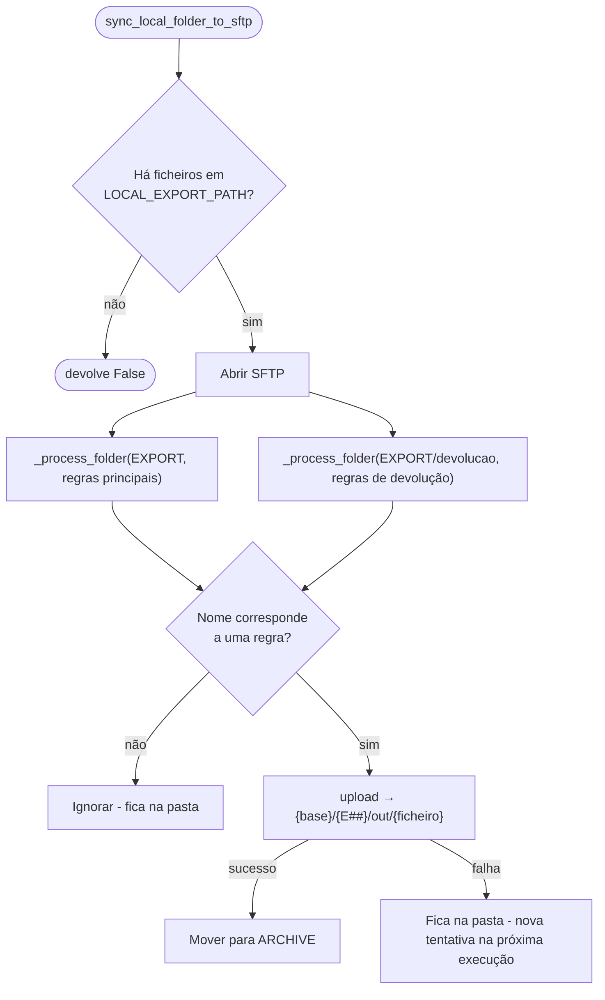

# Envio de ficheiros (X3 → Magento)

Implementado por [`sync_local_folder_to_sftp()`][app.services.file_handler.sync_local_folder_to_sftp].

Envia para o SFTP os ficheiros que o Sage X3 exporta para `LOCAL_EXPORT_PATH`, encaminhando
cada um para a pasta da loja correta com base no nome do ficheiro.

## Fluxo



## Regras de roteamento

O código da loja (`##`, dois dígitos) é extraído do nome do ficheiro e a pasta remota fica
`E##`. A pesquisa não distingue maiúsculas/minúsculas e procura o padrão **em qualquer posição**
do nome.

| Pasta local              | Padrão (regex)  | Tipo de documento (provável) | Pasta remota |
| ------------------------ | --------------- | ---------------------------- | ------------ |
| `LOCAL_EXPORT_PATH`      | `EDIEE(\d{2})`  | EDI — entradas               | `E##`        |
| `LOCAL_EXPORT_PATH`      | `EDISE(\d{2})`  | EDI — saídas                 | `E##`        |
| `LOCAL_EXPORT_PATH`      | `PRODE(\d{2})`  | Produtos                     | `E##`        |
| `LOCAL_EXPORT_PATH/devolucao` | `RECE(\d{2})` | Devoluções / receções     | `E##`        |

Exemplo:

```text
LOCAL_EXPORT_PATH\EDISE05_20251105.txt
        └─► {SFTP_SYNC_BASE_PATH}/E05/out/EDISE05_20251105.txt
LOCAL_EXPORT_PATH\devolucao\RECE12_000981.txt
        └─► {SFTP_SYNC_BASE_PATH}/E12/out/RECE12_000981.txt
```

As regras estão definidas como dicionários `{regex compilada: modelo}` dentro de
`sync_local_folder_to_sftp`; o modelo pode usar `{code}` para o grupo capturado
(ver [`_get_remote_destination`][app.services.file_handler._get_remote_destination]).

!!! tip "Acrescentar um novo tipo de ficheiro"
    Adicionar uma entrada a `main_folder_rules` (ou `devolucao_folder_rules`):

    ```python
    re.compile(r'NOVOE(\d{2})', re.IGNORECASE): 'E{code}',
    ```

## Arquivo

Após o envio de **cada pasta**, os ficheiros enviados com sucesso são movidos para
`LOCAL_ARCHIVE_PATH` (a mesma pasta para os dois casos). Se já existir um ficheiro com o mesmo
nome no arquivo, o comportamento depende de `shutil.move` (em Windows gera erro, que é registado).
