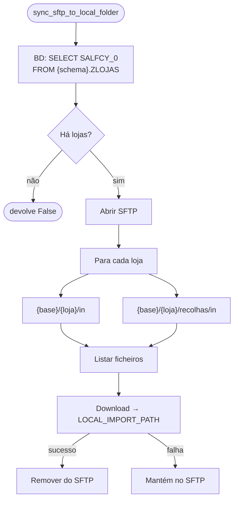

# Receção de ficheiros (Magento → X3)

Implementada por [`sync_sftp_to_local_folder()`][app.services.file_handler.sync_sftp_to_local_folder].

Descarrega os ficheiros que o Magento coloca nas pastas de entrada de cada loja para
`LOCAL_IMPORT_PATH`, de onde o Sage X3 os importa.

## Fluxo

## Pastas verificadas

Para cada código `SALFCY_0` da tabela `ZLOJAS`:

| Pasta remota                                   | Conteúdo (provável)     |
| ---------------------------------------------- | ----------------------- |
| `{SFTP_SYNC_BASE_PATH}/{loja}/in`              | Encomendas / documentos |
| `{SFTP_SYNC_BASE_PATH}/{loja}/recolhas/in`     | Recolhas                |

Pastas inexistentes são registadas como *warning* e ignoradas.

## Garantias

- Um ficheiro **só é removido do SFTP depois de descarregado com sucesso**.
- Todos os ficheiros vão para a **mesma** pasta local (`LOCAL_IMPORT_PATH`), sem subpastas por
  loja. Se dois ficheiros de lojas diferentes tiverem o mesmo nome, o segundo **sobrescreve** o
  primeiro.
- `listdir` devolve também subdiretórios; uma tentativa de "download" de um subdiretório falha
  e é registada como erro, sem consequências para os restantes ficheiros.
