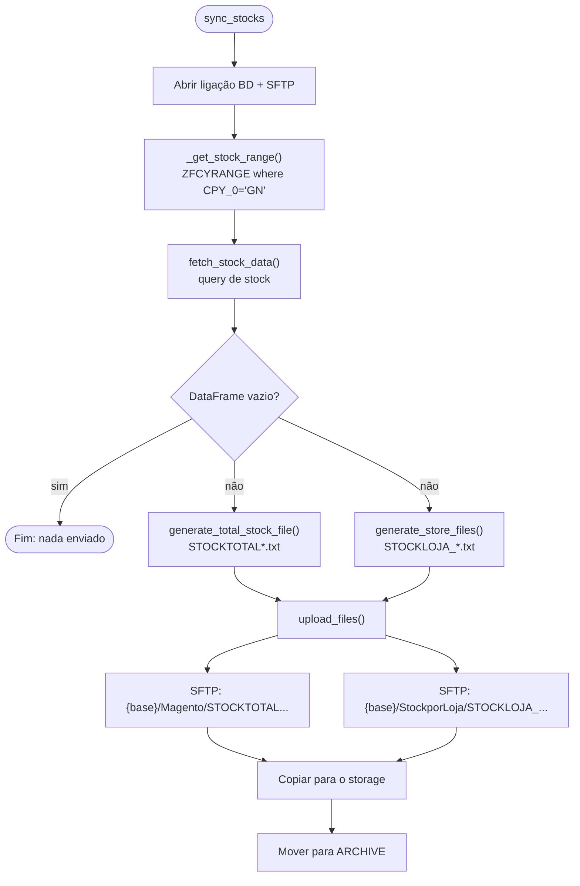

# Sincronização de stocks

Implementada por [`sync_stocks()`][app.services.file_handler.sync_stocks] com a classe
[`StockSync`][app.services.stock_sync.StockSync].

!!! info "Frequência"
    Por omissão, diariamente das 08:00 às 23:00, de hora a hora. Ver
    [Agendamento](agendamento.md).

## Fluxo



## 1. Intervalo de armazéns

```sql
SELECT FCY_0, FCY_1 FROM {schema}.ZFCYRANGE WHERE CPY_0 = 'GN'
```

O primeiro registo define o intervalo `[FCY_0, FCY_1]` de armazéns a considerar.

## 2. Extração do stock

```sql
SELECT ITV.STOFCY_0, ITV.ITMREF_0, ITM.ZITMDES_0,
       CONVERT(int, (ITV.PHYSTO_0 - ITV.PHYALL_0 - ITV.GLOALL_0)) AS AVLSTO_0,
       PRI.P1PVP_0, PRI.P2PVP_0, PRI.P2_0
FROM {schema}.ITMMVT ITV
INNER JOIN {schema}.ITMMASTER ITM ON ITM.ITMREF_0 = ITV.ITMREF_0 AND ITM.ITMSTA_0 = 1
INNER JOIN ZITMPRI PRI   ON PRI.ITMREF_0 = ITV.ITMREF_0
INNER JOIN FACILITY FCY  ON FCY.FCY_0 = ITV.STOFCY_0
                        AND FCY.LEGCPY_0 = 'GN' AND FCY.WRHFLG_0 = 2
                        AND FCY.FCY_0 <> 'E30'
WHERE ITV.STOFCY_0 BETWEEN '{FCY_0}' AND '{FCY_1}'
ORDER BY ITV.ITMREF_0, ITV.STOFCY_0
```

**Stock disponível** = stock físico − alocado físico − alocado global, truncado a inteiro.

## 3. Ficheiros gerados

Todos os ficheiros são CSV **sem cabeçalho**, separador `;`, decimal `,`, codificação UTF-8,
gravados em `LOCAL_EXPORT_PATH`. O sufixo `AAMMDDhhmmss` é a data/hora de geração.

### Stock total — `STOCKTOTALAAMMDDhhmmss.txt`

Uma linha por artigo, com o stock somado de todos os armazéns.

| # | Coluna      | Descrição                       |
| - | ----------- | ------------------------------- |
| 1 | `ITMREF_0`  | Referência do artigo            |
| 2 | `ZITMDES_0` | Descrição (sem espaços extremos)|
| 3 | `AVLSTO_0`  | Soma do stock disponível        |
| 4 | `P1PVP_0`   | Preço 1                         |
| 5 | `P2PVP_0`   | Preço 2                         |
| 6 | `P2_0`      | Preço P2                        |

Destino remoto: `{SFTP_SYNC_BASE_PATH}/Magento/`.

### Stock por loja — `STOCKLOJA_{loja}AAMMDDhhmmss.txt`

Um ficheiro por armazém (`STOFCY_0`), **apenas com artigos com stock > 0**. Lojas sem
nenhum artigo com stock não geram ficheiro.

| # | Coluna      |
| - | ----------- |
| 1 | `ITMREF_0`  |
| 2 | `ZITMDES_0` |
| 3 | `AVLSTO_0`  |
| 4 | `P1PVP_0`   |
| 5 | `P2PVP_0`   |
| 6 | `P2_0`      |
| 7 | `STOFCY_0`  |

Destino remoto: `{SFTP_SYNC_BASE_PATH}/StockporLoja/`.

```text title="Exemplo de linha"
ART000123;Camisola algodão azul M;14;19,99;17,99;12,5;E05
```

## 4. Envio e arquivo

Cada ficheiro enviado com sucesso é copiado para o storage e depois movido para
`LOCAL_ARCHIVE_PATH`:

| Ficheiro       | Pasta no storage (`STORAGE_ARCHIVE_PATH`) |
| -------------- | ----------------------------------------- |
| Stock total    | `STOCK\STOCKTOTAL`                        |
| Stock por loja | `STOCK\STOCKPORLOJA`                      |

Uma falha na cópia para o storage é registada em log, mas o ficheiro é arquivado na mesma e não
há nova tentativa de cópia. Ficheiros cujo envio
falhou **permanecem** em `LOCAL_EXPORT_PATH` e não são reenviados automaticamente (os nomes
`STOCK*` não correspondem às [regras de roteamento](envio.md#regras-de-roteamento) do fluxo de envio).
