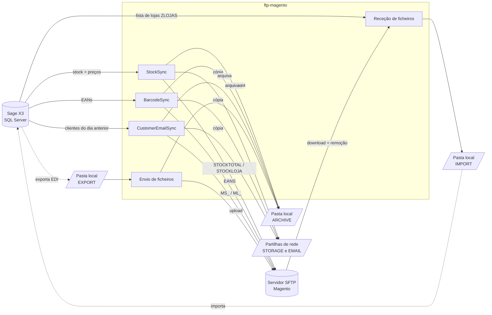

# GN · FTP Magento

Serviço Python que **integra o ERP Sage X3 com a loja Magento** através de um servidor **SFTP**.
Corre como processo de longa duração (modo agendado) ou como execução única, e trata de cinco fluxos:

-   :material-package-variant-closed: **Sincronização de stocks**

    ---

    Lê o stock disponível e os preços do X3 (SQL Server), gera um ficheiro de stock total e um
    ficheiro por loja, envia-os para o SFTP e guarda uma cópia no storage de rede.

    [:octicons-arrow-right-24: Ver fluxo](funcionamento/stocks.md)

-   :material-barcode: **Códigos de barras**

    ---

    Extrai os códigos de barras dos artigos do X3, gera um ficheiro, envia-o para o SFTP e
    guarda uma cópia no storage de rede.

    [:octicons-arrow-right-24: Ver fluxo](funcionamento/codigos-barras.md)

-   :material-email-outline: **Emails de satisfação**

    ---

    Extrai os clientes do dia anterior, gera um ficheiro para o site e outro para as lojas,
    envia-os para o SFTP e guarda uma cópia na pasta de emails.

    [:octicons-arrow-right-24: Ver fluxo](funcionamento/emails.md)

-   :material-upload: **Envio X3 → Magento**

    ---

    Envia os ficheiros EDI exportados pelo X3 (`EDIEE`, `EDISE`, `PRODE`, `RECE`) para a pasta
    `out` da loja correspondente e arquiva-os localmente.

    [:octicons-arrow-right-24: Ver fluxo](funcionamento/envio.md)

-   :material-download: **Receção Magento → X3**

    ---

    Para cada loja registada na tabela `ZLOJAS`, descarrega os ficheiros das pastas `in` e
    `recolhas/in` do SFTP e remove-os do servidor.

    [:octicons-arrow-right-24: Ver fluxo](funcionamento/rececao.md)

-   :material-clock-outline: **Agendamento**

    ---

    Cada rotina tem a sua janela horária e intervalo, configuráveis por variáveis de ambiente.

    [:octicons-arrow-right-24: Ver agendamento](funcionamento/agendamento.md)

## Visão geral

## Stack tecnológica

| Componente              | Biblioteca                                                    |
| ----------------------- | ------------------------------------------------------------- |
| Acesso à base de dados  | [SQLAlchemy 2](https://www.sqlalchemy.org/) + `pymssql`       |
| Manipulação de dados    | [pandas](https://pandas.pydata.org/)                          |
| SFTP                    | [paramiko](https://www.paramiko.org/)                         |
| Configuração            | [python-decouple](https://github.com/HBNetwork/python-decouple) (`.env`) |
| Gestão de dependências  | [uv](https://docs.astral.sh/uv/) · Python ≥ 3.12              |
| Lint / formatação       | [ruff](https://docs.astral.sh/ruff/)                          |

## Por onde começar

1. [Instalação](guia/instalacao.md) — preparar o ambiente.
2. [Configuração](guia/configuracao.md) — variáveis do `.env` e ficheiro `known_hosts`.
3. [Execução e operação](guia/operacao.md) — como correr, logs e resolução de problemas.
4. [Arquitetura](funcionamento/arquitetura.md) — como o código está organizado.
5. [Análise técnica](analise-tecnica.md) — pontos de atenção e melhorias recomendadas.
